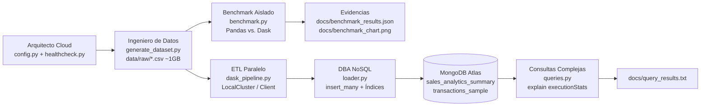

# Integración de Python, Procesamiento Paralelo con Dask y Persistencia NoSQL en MongoDB Atlas

Proyecto modular orientado a prácticas evaluadas de Ingeniería de Datos, Bases de Datos NoSQL y Arquitectura Cloud. Implementa un flujo completo de Big Data desde la generación particionada de millones de transacciones e-commerce hasta su procesamiento distribuido con **Dask**, comparativa rigurosa frente a **Pandas**, persistencia desnormalizada con índices compuestos en **MongoDB Atlas** y consultas analíticas perfiladas con `.explain("executionStats")`.

---

## División Modular por Roles Técnicos

| Rol Técnico | Directorio / Módulos | Responsabilidades Clave |
| :--- | :--- | :--- |
| **1. Ingeniero de Datos** | [`src/data_engineer/`](src/data_engineer/)<br>- `generate_dataset.py`<br>- `dask_pipeline.py`<br>- `benchmark.py` | Generación de dataset masivo particionado (5M–10M filas, ~1 GB–2 GB), pipeline ETL perezoso con `dask.dataframe` (`blocksize`, `LocalCluster`/`Client`, `.compute()` único al final) y benchmark aislado de tiempo y pico RAM (Pandas vs. Dask). |
| **2. DBA NoSQL** | [`src/dba_nosql/`](src/dba_nosql/)<br>- `mongo_client.py`<br>- `loader.py`<br>- `queries.py` | Conexión segura TLS/SRV a MongoDB Atlas con validación `ping`, esquema desnormalizado (`sales_analytics_summary` + `transactions_sample`), carga masiva por lotes `insert_many(..., ordered=False)`, índices compuestos ESR y 3 consultas complejas con `.explain("executionStats")`. |
| **3. Arquitecto Cloud** | [`src/cloud_architect/`](src/cloud_architect/)<br>- `config.py`<br>- `healthcheck.py` | Gestión centralizada de variables de entorno con `python-dotenv`, enmascaramiento seguro de credenciales, configuración de timeouts de red AWS/GCP ↔ MongoDB Atlas y diagnóstico integral (CPU/RAM/disco, Dask y Atlas). |

---

## Arquitectura del Flujo End-to-End



---

## Estructura del Repositorio

```text
.
├── data/                         # Ignorado en .gitignore (archivos CSV/Parquet masivos)
│   └── raw/
├── docs/
│   ├── REPORTE_TECNICO.md        # Plantilla de informe lista para exportar a PDF
│   ├── benchmark_results.json    # Evidencia numérica Pandas vs. Dask
│   ├── benchmark_chart.png       # Gráfica comparativa (tiempo y pico de RAM)
│   └── query_results.txt         # Salida de las 3 consultas complejas + executionStats
├── src/
│   ├── data_engineer/
│   │   ├── generate_dataset.py
│   │   ├── dask_pipeline.py
│   │   └── benchmark.py
│   ├── dba_nosql/
│   │   ├── mongo_client.py
│   │   ├── loader.py
│   │   └── queries.py
│   └── cloud_architect/
│       ├── config.py
│       └── healthcheck.py
├── main.py                       # Orquestador End-to-End
├── .env.example                  # Plantilla de variables de entorno
├── .gitignore
├── requirements.txt
└── README.md
```

---

## Instalación y Configuración

### 1. Crear y activar el entorno virtual

```bash
python3 -m venv .venv
source .venv/bin/activate
pip install -r requirements.txt
```

### 2. Configurar credenciales de MongoDB Atlas

Copia `.env.example` a `.env` y pega tu cadena de conexión real (`MONGO_URI`):

```bash
cp .env.example .env
```

Edita `.env`:

```env
MONGO_URI=mongodb+srv://<tu_usuario>:<tu_password>@<tu_cluster>.mongodb.net/?retryWrites=true&w=majority&appName=BigDataLab
MONGO_DB_NAME=ecommerce_bigdata_analytics
DASK_N_WORKERS=4
DATASET_ROWS=5000000
```

> **Nota de seguridad Cloud:** Asegúrate de agregar tu IP pública (o el CIDR / VPC Peering de tu instancia AWS EC2 / GCP Compute Engine) en **MongoDB Atlas → Network Access**. Nunca subas el archivo `.env` a Git.

---

## Instrucciones de Ejecución

### Ejecución completa End-to-End (Recomendado)

```bash
.venv/bin/python main.py
```

El orquestador ejecutará en orden:
1. `healthcheck` (CPU/RAM, clúster Dask y `ping` a MongoDB Atlas).
2. Generación de dataset particionado (si aún no existe en `data/raw/`).
3. Benchmark Pandas secuencial vs. Dask paralelo (`docs/benchmark_results.json` y `docs/benchmark_chart.png`).
4. ETL paralelo con Dask y carga masiva en lotes a MongoDB Atlas con índices compuestos.
5. Ejecución de las 3 consultas complejas con `.explain("executionStats")` guardadas en `docs/query_results.txt`.

### Ejecución modular por rol (opcional)

```bash
# Arquitecto Cloud: diagnóstico de infraestructura
.venv/bin/python -m src.cloud_architect.healthcheck --json

# Ingeniero de Datos: generar dataset y ejecutar benchmark
.venv/bin/python -m src.data_engineer.generate_dataset --rows 5000000 --partitions 20
.venv/bin/python -m src.data_engineer.benchmark

# DBA NoSQL: re-ejecutar únicamente las 3 consultas complejas sobre Atlas
.venv/bin/python -m src.dba_nosql.queries

# Orquestador sin volver a correr el benchmark (solo ETL + Atlas + Queries + PDF)
.venv/bin/python main.py --skip-benchmark

# Arquitecto Cloud: regenerar el Reporte Técnico en PDF (incluyendo capturas en docs/screenshots/)
.venv/bin/python -m src.cloud_architect.export_pdf
```

---

## Generación del Reporte PDF con Capturas Cloud (AWS/GCP y MongoDB Atlas)

1. Coloca tus capturas reales de infraestructura Cloud y Atlas en `docs/screenshots/` siguiendo la guía [`docs/screenshots/README.txt`](docs/screenshots/README.txt):
   - `01_cloud_compute_aws_gcp.png` (Instancia AWS EC2 / GCP Compute Engine operando)
   - `02_cloud_network_security.png` (Security Groups / VPC Firewall TCP 27017 y Atlas Network Access)
   - `03_mongodb_atlas_cluster.png` (Panel principal / métricas del clúster MongoDB Atlas)
   - `04_mongodb_atlas_collections_indexes.png` (Colecciones e índices compuestos en Atlas)
   - `05_terminal_healthcheck_pipeline.png` (Ejecución de `healthcheck.py` y `main.py` en consola)
2. Ejecuta:
   ```bash
   .venv/bin/python -m src.cloud_architect.export_pdf
   ```
   Esto genera/actualiza automáticamente `docs/REPORTE_TECNICO.pdf` integrando los datos reales del benchmark, la gráfica comparativa, las consultas de MongoDB Atlas y todas las capturas colocadas en `docs/screenshots/`.
