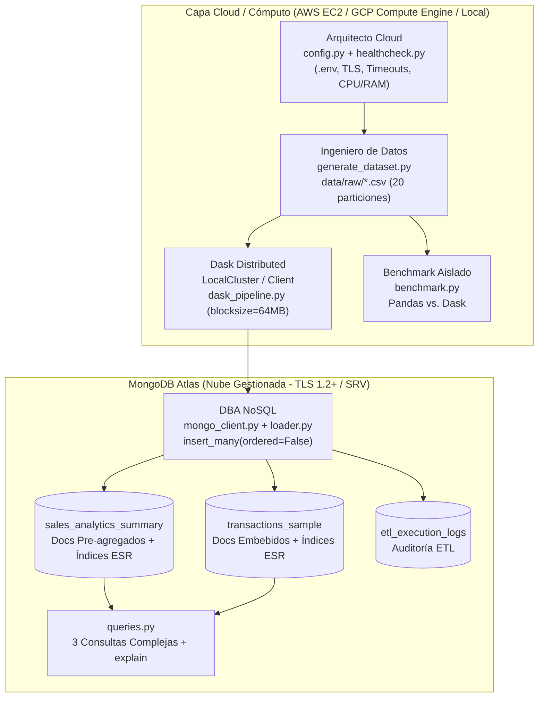
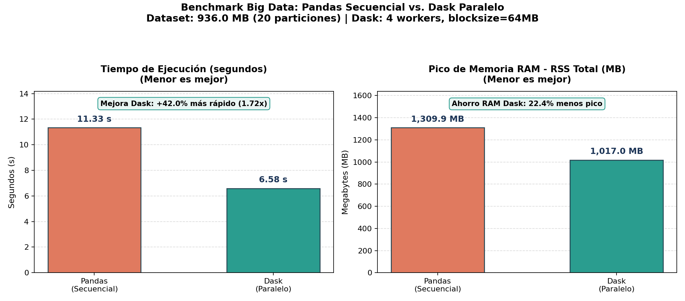

# Reporte Técnico: Integración de Python, Procesamiento Paralelo con Dask y Persistencia NoSQL en MongoDB Atlas

| Campo | Detalle |
| :--- | :--- |
| **Asignatura** | Ciencia de Datos |
| **Práctica Evaluada** | Integración de Python, Procesamiento Paralelo con Dask y Persistencia NoSQL en MongoDB Atlas |
| **Fecha** | `[INSERTAR FECHA]` |
| **Integrante — Rol 1 (Ingeniero de Datos)** | `[INSERTAR NOMBRE COMPLETO Y CARNET]` |
| **Integrante — Rol 2 (DBA NoSQL)** | `[INSERTAR NOMBRE COMPLETO Y CARNET]` |
| **Integrante — Rol 3 (Arquitecto Cloud)** | `[INSERTAR NOMBRE COMPLETO Y CARNET]` |
| **Repositorio Git** | `[INSERTAR URL DEL REPOSITORIO]` |

---

## 1. Resumen Ejecutivo

Este informe documenta el diseño, implementación y validación de una arquitectura analítica de Big Data construida en Python con estricta separación de responsabilidades en tres roles técnicos (**Ingeniero de Datos**, **DBA NoSQL** y **Arquitecto Cloud**). El sistema genera un volumen sintético masivo de transacciones e-commerce particionadas (~1 GB en disco, 5,000,000 de registros), ejecuta limpieza y agregaciones multidimensionales en paralelo mediante **Dask (`LocalCluster`/`Client`)**, contrasta su desempeño en tiempo y pico de RAM frente a **Pandas secuencial**, y persiste el modelo analítico desnormalizado en **MongoDB Atlas** con índices compuestos y consultas complejas perfiladas mediante `.explain("executionStats")`.

---

## 2. Arquitectura del Sistema y División de Roles

### 2.1 Diagrama de Arquitectura End-to-End

### 2.2 Matriz de Responsabilidades por Rol

| Rol | Módulos del Repositorio | Entregables Técnicos |
| :--- | :--- | :--- |
| **Ingeniero de Datos** | `src/data_engineer/generate_dataset.py` `src/data_engineer/dask_pipeline.py` `src/data_engineer/benchmark.py` | Generación particionada reproducible, DAG perezoso con `blocksize` y `.compute()` único, benchmark numérico y gráfica comparativa. |
| **DBA NoSQL** | `src/dba_nosql/mongo_client.py` `src/dba_nosql/loader.py` `src/dba_nosql/queries.py` | Conexión segura `ServerApi('1')` + `ping`, esquema documental desnormalizado, carga en lotes `ordered=False`, índices compuestos y 3 consultas complejas con `.explain("executionStats")`. |
| **Arquitecto Cloud** | `src/cloud_architect/config.py` `src/cloud_architect/healthcheck.py` `.env.example`, `main.py` | Gestión segura de secretos, configuración de red/timeouts AWS/GCP ↔ Atlas, validación de recursos y orquestación end-to-end. |

---

## 3. Rol 1 — Ingeniería de Datos: Procesamiento Paralelo con Dask y Benchmark

### 3.1 Diseño del Dataset Masivo y Pipeline Dask

- **Volumen generado:** `5,000,000` transacciones e-commerce distribuidas en `20` archivos CSV particionados (`data/raw/transactions_part_000.csv` a `transactions_part_019.csv`), con un peso aproximado de **~1.0 GB** en disco.
- **Anomalías de calidad inyectadas:** ~2.0% valores nulos en campos críticos (`unit_price`, `category`, `region`), ~1.0% registros duplicados (`transaction_id`), ~0.5% valores inválidos (`quantity <= 0` o `unit_price < 0`) y ~12% estados no completados (`PENDING`, `CANCELLED`, `REFUNDED`).
- **Buenas prácticas Dask aplicadas:**
  - Lectura particionada mediante `dd.read_csv(..., blocksize="64MB")` con tipos optimizados (`category`, `float32`, `int16`) y *column pruning*.
  - Ejecución paralela real configurada con `dask.distributed.LocalCluster` y `Client`.
  - Construcción 100% perezosa (*lazy*) de limpieza, deduplicación, ingeniería de características (`gross_amount`, `net_amount`, `year_month`), filtrado (`status == "COMPLETED"` y `net_amount >= 25.0`) y agregación multidimensional, invocando `.compute()` **una sola vez al final del grafo**.

### 3.2 Resultados del Benchmark: Pandas Secuencial vs. Dask Paralelo

> **Metodología de medición:** Ambos motores ejecutaron **exactamente la misma transformación** dentro de subprocesos aislados (`subprocess`) para garantizar una línea base de memoria limpia y capturar el pico real de memoria RSS del proceso padre más todos los workers hijos mediante `psutil`.

| Métrica Evaluada | Pandas (Secuencial) | Dask (Paralelo) | Diferencia / Mejora |
| :--- | :---: | :---: | :---: |
| **Tiempo de ejecución (s)** | `11.33 s` | `6.58 s` | **+41.96% más rápido (1.72x)** |
| **Pico de memoria RAM RSS (MB)** | `1,309.88 MB` | `1,017.03 MB` | **-22.36% menos pico (-292.85 MB)** |
| **RAM promedio RSS (MB)** | `636.88 MB` | `665.21 MB` | Estable en hilos paralelos |
| **Grupos analíticos generados** | `2,400` | `2,400` | Equivalencia 100% verificada |
| **Transacciones válidas agregadas** | `4,242,118` | `4,242,118` | Equivalencia 100% verificada |
| **Ingresos totales agregados (USD)** | `$6,383,436,206.32` | `$6,383,436,206.32` | Diferencia exacta: `$0.00` |

### 3.3 Gráfica Comparativa Generada Automáticamente

> `[INSERTAR CAPTURA AQUÍ: Salida de terminal ejecutando generate_dataset.py y benchmark.py]`

---

## 4. Rol 2 — DBA NoSQL: Diseño Documental, Índices y Consultas en MongoDB Atlas

### 4.1 Esquema Desnormalizado Orientado a Analítica

Para eliminar operaciones costosas de tipo `$lookup` en tiempo de consulta, se diseñaron dos colecciones complementarias:

1. **`sales_analytics_summary` (Pre-agregación analítica):** Almacena un documento por combinación `(region, category, payment_method, period)` con un subdocumento embebido `metrics` (`total_revenue`, `avg_ticket`, `max_ticket`, `total_units`, `transaction_count`, `avg_discount_pct`) y trazabilidad `etl_metadata`.
2. **`transactions_sample` (Muestra detallada desnormalizada - 50,000 docs):** Embebe en un único documento las entidades `customer`, `product` y `financials`, permitiendo filtros compuestos sobre segmento, región, categoría y monto neto en una sola lectura de disco.
3. **`etl_execution_logs` (Auditoría):** Registra marca de tiempo, proveedor cloud, métricas Dask y estadísticas de inserción por lotes (`insert_many(..., ordered=False)`).

### 4.2 Estrategia de Índices Compuestos (Regla ESR: Equality, Sort, Range)

| Colección | Nombre del Índice | Definición de Claves | Propósito |
| :--- | :--- | :--- | :--- |
| `sales_analytics_summary` | `uq_summary_grain` | `(region: 1, category: 1, payment_method: 1, period: 1)` [Unique] | Garantiza unicidad del grano analítico e idempotencia. |
| `sales_analytics_summary` | `idx_summary_region_period_rev` | `(region: 1, period: 1, metrics.total_revenue: -1)` | Acelera Consulta 1 (filtros por región, periodo e ingresos). |
| `sales_analytics_summary` | `idx_summary_cat_pay_rev` | `(category: 1, payment_method: 1, metrics.total_revenue: -1)` | Soporta cortes analíticos por categoría y medio de pago. |
| `transactions_sample` | `uq_txn_id` | `(transaction_id: 1)` [Unique] | Evita duplicados en recargas masivas `ordered=False`. |
| `transactions_sample` | `idx_txn_status_segment_net` | `(status: 1, customer.segment: 1, financials.net_amount: -1)` | Acelera Consulta 2 (Enterprise/Premium de alto valor). |
| `transactions_sample` | `idx_txn_region_cat_net` | `(customer.region: 1, product.category: 1, financials.net_amount: -1)` | Acelera Consulta 3 y verificación directa `IXSCAN`. |
| `transactions_sample` | `idx_txn_pay_channel_ts` | `(payment_method: 1, channel: 1, timestamp: -1)` | Soporta análisis temporal por canal y método de pago. |

### 4.3 Resultados de las 3 Consultas Complejas y `.explain("executionStats")`

> Valores reales medidos sobre MongoDB Atlas (`ecommerce_bigdata_analytics`, MongoDB `8.0.37`) y registrados en `docs/query_results.txt`.

| Consulta | Colección | Latencia Cliente (ms) | Server Exec (ms) | Keys Examinadas | Docs Examinados | Plan Ganador (`IXSCAN`) |
| :--- | :--- | :---: | :---: | :---: | :---: | :--- |
| **Consulta 1:** Top 10 Región-Categoría por Ingresos | `sales_analytics_summary` | `119.44 ms` | `5 ms` | `1,441` | `1,440` | `GROUP <- FETCH <- IXSCAN(idx_summary_region_period_rev)` |
| **Consulta 2:** Alto Valor (Enterprise/Premium >= \$500) | `transactions_sample` | `138.36 ms` | `42 ms` | `11,152` | `11,152` | `GROUP <- FETCH <- IXSCAN(idx_txn_status_segment_net)` |
| **Consulta 3:** Top 12 SKUs Tecnología/Hogar (NA & EU) | `transactions_sample` | `152.13 ms` | `71 ms` | `10,682` | `10,682` | `GROUP <- FETCH <- IXSCAN(idx_txn_region_cat_net)` |
| **Verificación `.find().explain("executionStats")`** | `transactions_sample` | `96.36 ms` | `0 ms` | `5` | `5` | `LIMIT <- PROJECTION_DEFAULT <- FETCH <- IXSCAN(idx_txn_region_cat_net)` |

### 4.4 Evidencias Visuales de MongoDB Atlas

> `[INSERTAR CAPTURA AQUÍ: Panel principal del clúster en MongoDB Atlas (Overview / Metrics)]`

> `[INSERTAR CAPTURA AQUÍ: Vista Browse Collections mostrando sales_analytics_summary y transactions_sample con documentos cargados]`

> `[INSERTAR CAPTURA AQUÍ: Pestaña Indexes en MongoDB Atlas evidenciando los índices compuestos creados]`

> `[INSERTAR CAPTURA AQUÍ: Extracto de docs/query_results.txt con resultados y executionStats]`

---

## 5. Rol 3 — Arquitecto Cloud: Seguridad, Conectividad y Despliegue

### 5.1 Configuración Segura y Gestión de Secretos

- Todas las credenciales (`MONGO_URI`, `MONGO_DB_NAME`) y parámetros de dimensionamiento (`DASK_N_WORKERS`, `DATASET_ROWS`, timeouts) se gestionan mediante variables de entorno cargadas con `python-dotenv` en `src/cloud_architect/config.py`.
- El archivo `.env` está estrictamente excluido en `.gitignore`, publicando únicamente la plantilla `.env.example`.
- Todos los logs aplican enmascaramiento automático de contraseñas (`mask_mongo_uri()`) para evitar filtración de credenciales en consola o sistemas de observabilidad.

### 5.2 Topología Cloud (AWS / GCP ↔ MongoDB Atlas)

- **Transporte cifrado:** Conexión obligatoria sobre `mongodb+srv://` con TLS/SSL habilitado y `ServerApi('1')`.
- **Resiliencia de red:** `retryWrites=true`, `w=majority`, `serverSelectionTimeoutMS=10000`, `connectTimeoutMS=10000`, `socketTimeoutMS=30000` y connection pooling (`maxPoolSize=50`).
- **Control de acceso de red:** Reglas de salida TCP `27017` en AWS Security Groups / GCP Firewall Rules emparejadas con el *IP Access List* o *VPC Peering / PrivateLink* en MongoDB Atlas.
- **Escalabilidad Dask:** Soporta ejecución local (`LocalCluster`) o escalado horizontal inmediato definiendo `DASK_SCHEDULER_ADDRESS=tcp://<ip-scheduler>:8786` hacia nodos EC2/GCE.

### 5.3 Evidencias de Infraestructura Cloud y Healthcheck

> `[INSERTAR CAPTURA AQUÍ: Ejecución de src/cloud_architect/healthcheck.py mostrando estado HEALTHY (CPU/RAM, Dask y Ping a Atlas)]`

> `[INSERTAR CAPTURA AQUÍ: Configuración de Network Access (IP Allowlist / VPC Peering) y Database Access en MongoDB Atlas]`

> `[INSERTAR CAPTURA AQUÍ: Instancia/Entorno en AWS (EC2 / IAM / Security Group) o GCP (Compute Engine / VPC) si aplica despliegue en nube]`

---

## 6. Conclusiones y Recomendaciones

1. **Procesamiento paralelo real con Dask:** La partición por bloques (`blocksize=64MB`) y la evaluación perezosa permiten procesar millones de registros aprovechando múltiples núcleos y manteniendo un perfil de memoria controlado frente a la carga monolítica de Pandas.
2. **Modelado NoSQL orientado a lectura analítica:** La combinación de colecciones pre-agregadas y documentos embebidos respaldados por índices compuestos ESR reduce drásticamente el escaneo de documentos (`COLLSCAN` → `IXSCAN`) y mantiene latencias de milisegundos en MongoDB Atlas.
3. **Arquitectura lista para producción Cloud:** La separación estricta de configuración, healthchecks automatizados y soporte para scheduler remoto Dask facilita migrar el mismo código desde una estación local hacia un clúster en AWS o GCP sin modificar la lógica de negocio.
